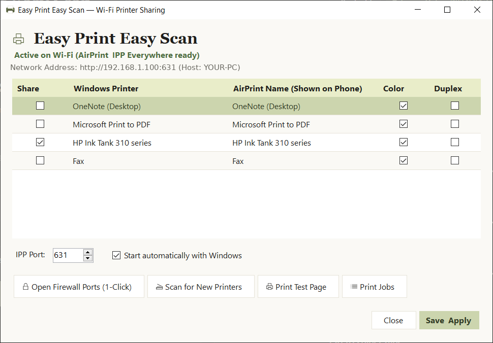
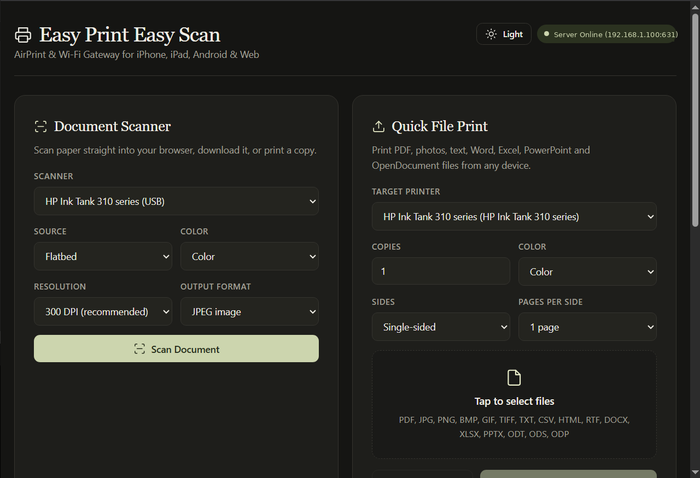
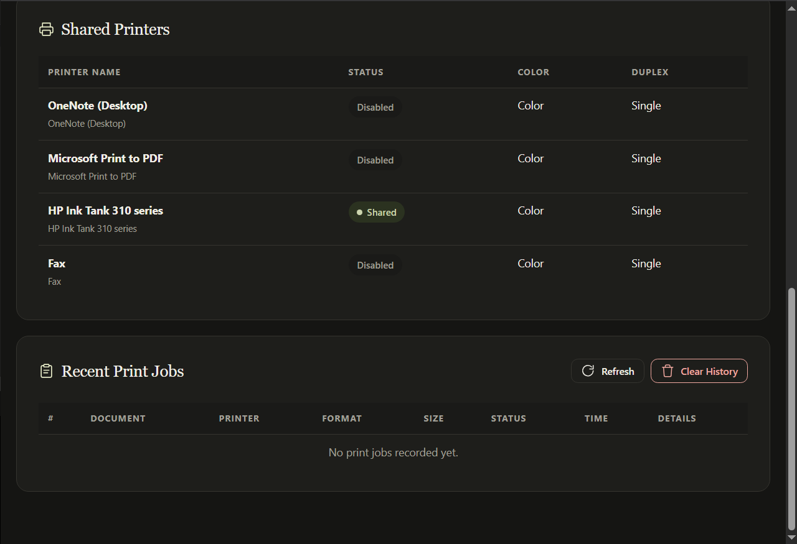

# 🖨️ Easy Print Easy Scan

> **Easy Print Easy Scan — a lightweight, native Windows single-executable app that shares your local printers over Wi-Fi for Apple AirPrint (iOS / iPadOS) and Android (IPP Everywhere / Mopria).**

---

## ⬇️ Download

[**Download the latest Windows release**](https://github.com/mnejjamohamed/easy-print-easy-scan/releases/latest) — no installer, just one `.exe`.

> Requires Windows 10/11 x64 and the [.NET 8 Desktop Runtime + ASP.NET Core Runtime](https://dotnet.microsoft.com/download/dotnet/8.0) and set your printer as shared from control panel . The executable is unsigned, so Windows SmartScreen may warn on first launch.

---

## 🖼️ Screenshots

### Windows Settings


### Web Dashboard




---

## 🌟 Key Highlights

- **Single `.exe` Application:** Everything runs in a single standalone executable. No complex Windows Service installation or multi-process setup needed.
- **System Tray Native:** Sits quietly in the Windows notification area. Right-click to toggle individual printers on/off or open settings.
- **AirPrint & Mopria Native:** Fully compliant with RFC 8010/8011 (IPP 2.0) and DNS-SD (mDNS). Your Windows printers show up automatically in the native iOS print dialog and Android Default Print Service.
- **100% Offline & Native:** Works completely on your local network. No cloud accounts, external servers, or internet connection needed.
- **Direct Windows Spooler Integration:** Uses native `winspool.drv` P/Invoke and GDI/PDF rendering to send print jobs directly into the Windows Spooler queue.
- **Print Job Monitor:** A built-in desktop window shows live and completed jobs, errors, and lets you reprint a stored job.
- **Web Scan & Print Hub:** Scan from a WIA flatbed or ADF scanner directly in the browser (JPEG, PNG or PDF), print uploaded files, and watch the job queue.
- **Wide File Support:** PDF, JPG, PNG, BMP, GIF, TIFF, TXT, CSV, HTML, RTF, DOCX, XLSX, PPTX, ODT, ODS, ODP, PCL and PostScript.
- **Built-in Tools:** 1-click Windows Firewall setup, test page printing, automatic startup on Windows login, and a web status dashboard.

---

## 📂 Project Architecture

```
PrintBridge/
├── PrintBridge.sln                         # Visual Studio solution file
├── src/
│   └── PrintBridge/
│       ├── PrintBridge.csproj              # Single .NET 8 WinForms + Kestrel project
│       ├── Program.cs                      # Entry point (single-instance mutex, CLI utilities)
│       ├── Models/
│       │   ├── AppSettings.cs              # Root settings model
│       │   ├── PrinterConfig.cs            # Individual printer toggle & configuration
│       │   ├── PrinterIdentity.cs          # Stable UUID / queue path helpers
│       │   └── PrintJob.cs                 # In-flight & completed print jobs
│       ├── Settings/
│       │   └── SettingsManager.cs          # %ProgramData%\PrintBridge\settings.json
│       ├── Network/
│       │   └── NetworkHelper.cs            # Wi-Fi / LAN IP and hostname resolution
│       ├── Discovery/
│       │   └── AirPrintAdvertiser.cs       # mDNS / Bonjour advertiser (Makaretu.Dns)
│       ├── Ipp/
│       │   ├── IppAttributes.cs            # RFC 8010 binary encoder / decoder
│       │   ├── IppServer.cs                # IPP operation handlers (Print-Job, Attributes, etc.)
│       │   └── IppMiddleware.cs            # ASP.NET Core Kestrel HTTP routing
│       ├── Printing/
│       │   ├── WindowsPrinterBridge.cs     # PDF / image / URF / Office / text printing
│       │   ├── PrintOptions.cs             # Copies, duplex, color, result model
│       │   ├── DocumentTextExtractor.cs    # DOCX/XLSX/PPTX/ODF/HTML/RTF text extraction
│       │   └── FirewallHelper.cs           # 1-click Windows Firewall automation
│       ├── Scanning/
│       │   ├── WiaScannerHelper.cs         # STA-safe WIA scanning & device enumeration
│       │   └── ScanPdfBuilder.cs           # Scanned image -> PDF conversion
│       ├── Server/
│       │   └── PrintBridgeServer.cs        # Orchestrates Kestrel & mDNS in background
│       └── UI/
│           ├── SettingsForm.cs             # Windows Forms settings window
│           ├── PrintJobsForm.cs            # Live print queue / reprint window
│           └── TrayApplicationContext.cs   # System Tray NotifyIcon & context menu
└── scripts/
    ├── build.bat                           # Compile the project
    ├── publish-single-file.bat             # Build standalone single PrintBridge.exe
    ├── setup-firewall.bat                  # 1-click firewall permission (TCP 631, UDP 5353)
    └── uninstall.bat                       # 1-click uninstaller & cleanup
```

---

## 🚀 How to Build & Run

### Prerequisites
- Windows 10 or Windows 11 (x64)
- [.NET 8.0 SDK](https://dotnet.microsoft.com/download/dotnet/8.0)

---

### Option A: Build the Single `.exe` (Recommended)

1. Double-click `scripts\publish-single-file.bat`, or run in PowerShell / Command Prompt:
   ```cmd
   dotnet publish src\PrintBridge\PrintBridge.csproj -c Release -r win-x64 --self-contained false -p:PublishSingleFile=true -p:IncludeNativeLibrariesForSelfExtract=true -o publish
   ```
2. Your standalone executable is ready:
   ```
   publish\PrintBridge.exe
   ```
3. Simply double-click `PrintBridge.exe` to run!

*(To build a self-contained `.exe` that runs on PCs **without** .NET 8 installed, change `--self-contained false` to `--self-contained true`)*.

---

### Option B: Run in Development Mode

Run directly from the repository root:
```cmd
dotnet run --project src\PrintBridge\PrintBridge.csproj
```
Or open `PrintBridge.sln` in **Visual Studio 2022** and press **F5**.

---

## 🛡️ Windows Firewall Setup

AirPrint and IPP require two ports to be open for inbound connections on your local Wi-Fi / Private network:
- **TCP 631:** IPP (Internet Printing Protocol) server
- **UDP 5353:** mDNS / Bonjour service discovery

### 1-Click Setup:
Right-click `scripts\setup-firewall.bat` and select **"Run as Administrator"** (or click the **"🛡️ Open Firewall Ports"** button right inside the PrintBridge Settings UI).

### Manual Setup (PowerShell Admin):
```powershell
New-NetFirewallRule -DisplayName "PrintBridge IPP" -Direction Inbound -Protocol TCP -LocalPort 631 -Action Allow -Profile Private,Domain
New-NetFirewallRule -DisplayName "PrintBridge mDNS" -Direction Inbound -Protocol UDP -LocalPort 5353 -Action Allow -Profile Private,Domain
```

---

## 📱 How to Print from Your Devices

Make sure your phone or tablet is connected to the **same Wi-Fi network** as your Windows PC.

### From iPhone or iPad (AirPrint):
1. Open any document, photo, or webpage (e.g. in Safari or Photos).
2. Tap the **Share** button (box with arrow) and tap **Print**.
3. Tap **Printer** — your Windows printer will appear automatically under *AirPrint Printers*.
4. Select color, double-sided, or copies, and tap **Print**.

### From Android (IPP Everywhere / Mopria):
1. Go to **Settings → Connected Devices → Connection Preferences → Printing**.
2. Ensure **Default Print Service** (or the free *Mopria Print Service* app) is enabled.
3. Open any file or webpage, tap **Print**, and your shared printer will be listed automatically.

### If the printer appears on iPhone but jobs do not print:
1. Open **Print Jobs** in the tray menu (or the web dashboard) and read the error shown for the job.
2. Make sure the PC and iPhone are on the **same subnet**, and that Windows Firewall allows **TCP 631** and **UDP 5353** on the Private profile.
3. Make sure no other service is already using port 631. The tray menu shows **"Not running"** if PrintBridge could not bind the port.
4. Use a printer driver that supports the physical printer (the built-in Windows driver is sufficient for GDI printing).
5. Print a **test page** from the Settings window to confirm the Windows queue itself works.

---

## ⚙️ Settings & Features

### System Tray Menu:
- **Address Header:** Shows your current local IP address and port (e.g. `192.168.1.150:631`), or a warning if the server failed to bind.
- **Printer Checkboxes:** Quickly enable or disable sharing for any individual printer with a single click.
- **Open Settings:** Opens the configuration screen.
- **Print Jobs:** Opens the live print queue with status, errors, clear history, and reprint.
- **View Web Dashboard:** Opens your default browser to `http://<your-ip>:631` for web printing, scanning, and job history.
- **Refresh Printers:** Re-scans Windows for newly installed printers without needing an app restart.

### Settings Window:
- **Share Toggles:** Select exactly which printers to advertise.
- **Custom AirPrint Name:** Give your printer a friendly name that appears on phones.
- **Color & Duplex:** Configure printer capabilities reported to mobile clients.
- **Test Page:** Click *"🖨️ Print Test Page"* to verify communication with the physical printer immediately.
- **Print Jobs:** Opens the print queue window.
- **Start with Windows:** Checkbox automatically registers `PrintBridge.exe` into Windows Startup (`HKCU\Software\Microsoft\Windows\CurrentVersion\Run`).

### Web Dashboard (`http://<your-ip>:631`):
- **Document Scanner:** Scan from a WIA flatbed or ADF, choose 150/300/600 DPI, color or grayscale, and save as JPEG, PNG or PDF. ADF scans capture every page into a single multi-page PDF. You can print the scan with one click, cancel an in-progress scan, or clear the scanned result afterwards.
- **Quick File Print:** Upload one or many files at once. Supports PDF, images, text, HTML/RTF, Microsoft Office (DOCX/XLSX/PPTX) and OpenDocument (ODT/ODS/ODP) files. A cancel button stops the in-progress print request and can also clear the selected file(s) before printing.
- **Dark / Light Theme:** Toggle the dashboard between light and dark mode; your choice is saved in the browser.
- **Print Jobs:** Live list with state and error details; clear the history when needed.

---

## 🧹 Easy Uninstallation

To remove PrintBridge:
1. Right-click the tray icon and select **Exit**.
2. Run `scripts\uninstall.bat` as Administrator (this cleans up the startup registry entry and removes the firewall rules).
3. Delete the `publish` or `PrintBridge` folder.

---

## 📄 License

MIT © 2026 MNEJJA Mohamed. See [LICENSE](LICENSE).
